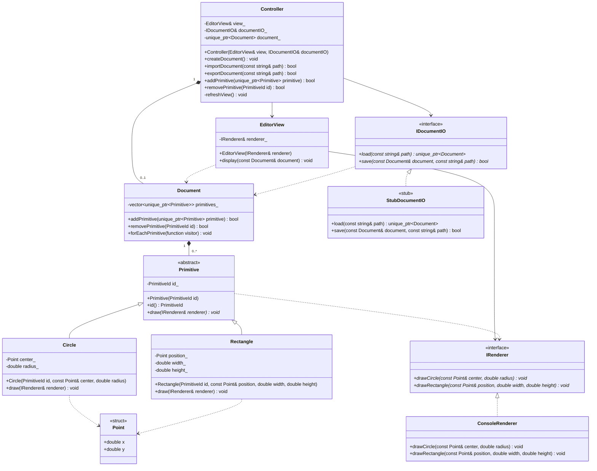

# Диаграмма классов

- `*--` — владение через `std::unique_ptr`;
- `-->` — ссылка без владения;
- `..>` — зависимость через параметр метода;
- `<|--` — наследование, `<|..` — реализация интерфейса;
- `*` в конце метода — чисто виртуальный метод.

`PrimitiveId` — псевдоним `std::size_t` из `Primitive.h`.
Обработчики GUI (`onNewDocument`, `onImportDocument`, `onExportDocument`,
`onAddCircle`, `onAddRectangle`, `onRemovePrimitive`) — свободные функции
в `src/main.cpp`, они получают `Controller&` и вызывают его методы.
